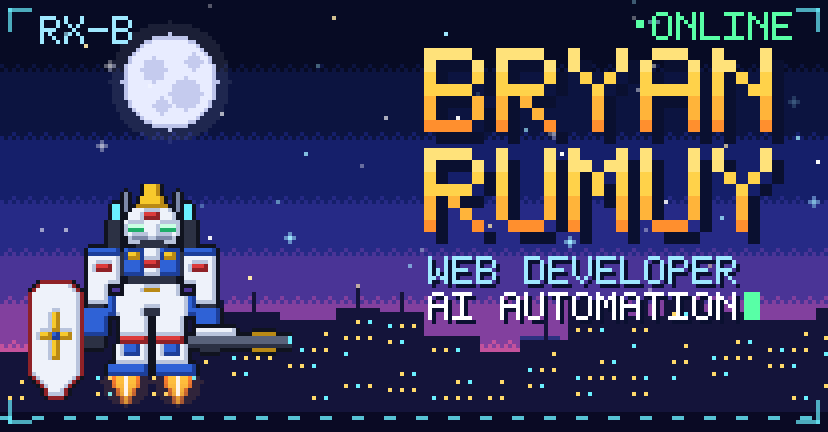
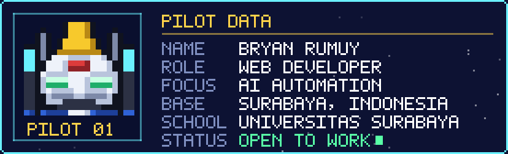
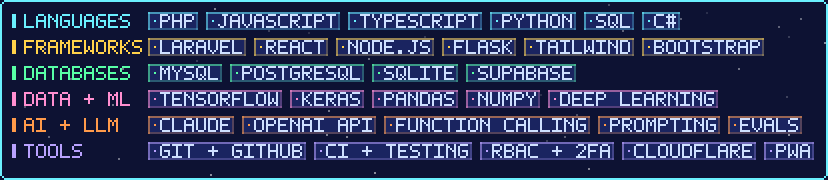
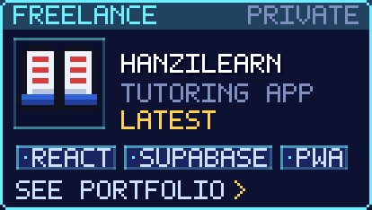
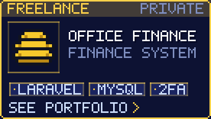
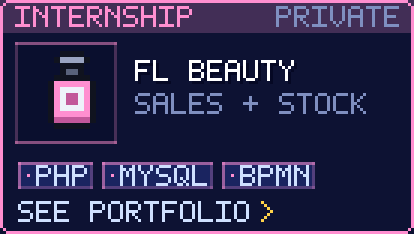
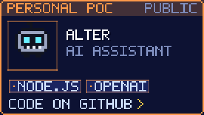
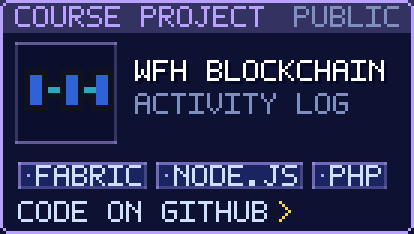
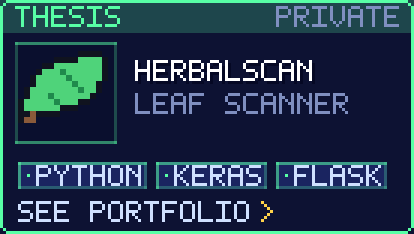
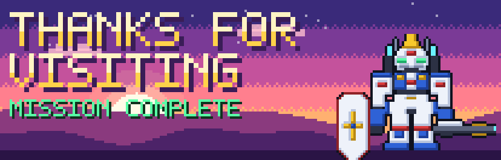

  

  
  
  

<i>I build web systems and AI automation that solve real business problems.</i>

<table>
  <tr>
    <td width="50%" valign="top">
       
      A tutoring app for a private Mandarin teacher: lessons, homework, invoices, HSK practice and push notifications.
    </td>
    <td width="50%" valign="top">
       
      Office bookkeeping with approvals, two-factor login, PDF and Excel reports, and 840+ automated tests.
    </td>
  </tr>
  <tr>
    <td width="50%" valign="top">
       
      Sales, purchasing and batch-level stock with expiry dates for a skincare shop, built in a campus internship.
    </td>
    <td width="50%" valign="top">
       
      An AI customer-service assistant that takes orders with function calling and hands complaints to staff. Demo with a fictional cafe.
    </td>
  </tr>
  <tr>
    <td width="50%" valign="top">
       
      Work-from-home activity records on a Hyperledger Fabric ledger. A group course project.
    </td>
    <td width="50%" valign="top">
       
      Identifies 10 Indonesian medicinal plants from a leaf photo using 15 voting models (99.34% test accuracy).
    </td>
  </tr>
</table>

  

All pixel art is drawn in code (see `tools`, run `npm run mecha`). The mecha and drone designs are original, inspired by classic giant-robot anime and not any official character.
