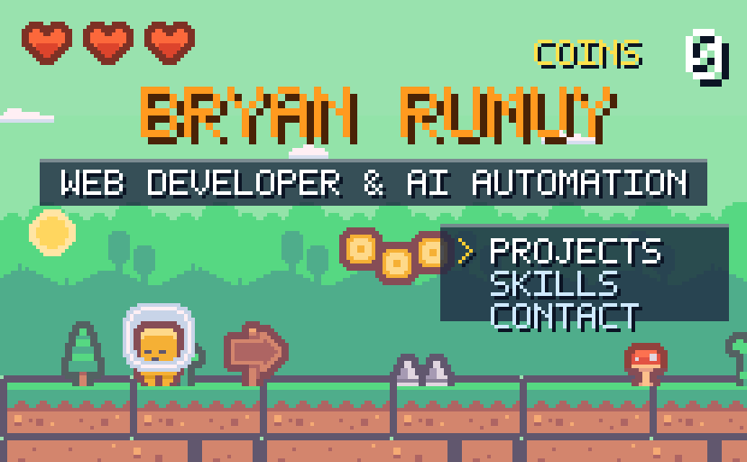
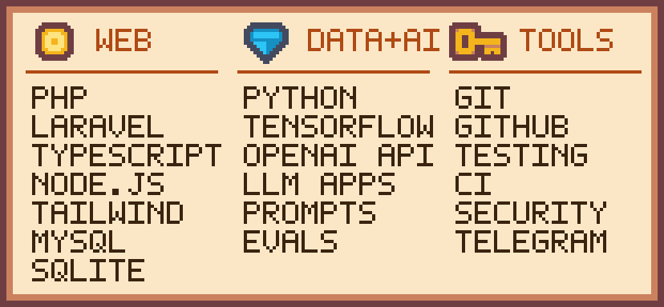
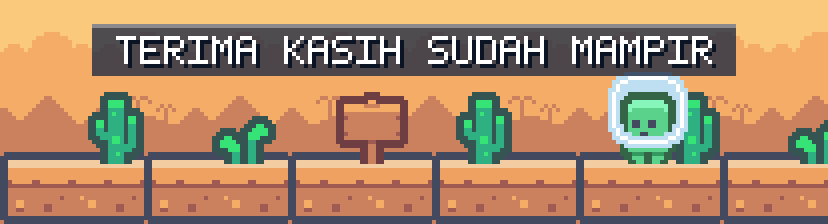

  

  <a href="https://bryanrumuy-porto.vercel.app/">Portofolio</a> &nbsp;|&nbsp;
  <a href="https://www.linkedin.com/in/bryanrumuy">LinkedIn</a> &nbsp;|&nbsp;
  Surabaya, Indonesia

## Tentang saya

Lulusan Teknik Informatika Universitas Surabaya (spesialisasi Data Science dan Artificial Intelligence). Saya membangun sistem web full-stack dan solusi AI yang menyelesaikan masalah bisnis nyata: dari rancangan basis data dan alur kerja, sampai pengujian, keamanan, dan penyerahan ke pengguna.

Sisi server saya kerjakan dengan **Laravel** dan **MySQL**, sisi antarmuka dengan **TypeScript**, **Tailwind CSS**, HTML dan CSS. Untuk AI, saya menyambungkan model bahasa ke aplikasi nyata (function calling, basis pengetahuan, evaluasi otomatis), dan memakai Python dan TensorFlow untuk machine learning. Saya terbuka untuk peran Data Scientist, Web Developer, dan AI Automation.

## Skill

  

## Project

| Project | Ringkasan |
|---|---|
| **[Alter](https://github.com/bryanrumuy/alter-ai-assistant)** | Asisten layanan pelanggan berbasis AI untuk bisnis kecil. Menjawab dari basis pengetahuan milik bisnis, menerima pesanan lewat function calling (item dibatasi menu, total dihitung kode), menyerahkan komplain dan keadaan darurat ke staf, dengan dasbor staf. Node.js, OpenAI API, SQLite. Proof of concept yang didemokan di Telegram dengan kafe fiktif. |
| **[Blockchain WFH Monitoring](https://github.com/bryanrumuy/blockchain-wfh-monitoring)** | Proyek kuliah kelompok: aktivitas kerja dari rumah dicatat di ledger Hyperledger Fabric lewat chaincode JavaScript, REST API Node.js, dan klien web PHP. README menjelaskan batasannya secara jujur. |
| **HerbalScan** (skripsi) | Aplikasi web yang mengenali 10 tanaman obat Indonesia dari foto daun. Lima model untuk masing-masing arsitektur MobileNetV2, ResNet50, dan VGG16 (15 model) memberi suara, dan gabungan suaranya mencapai akurasi 99,34% pada pengujian. Foto yang tidak meyakinkan ditolak. |
| **Sistem Keuangan Kantor** (freelance) | Aplikasi pencatatan keuangan kantor dengan empat peran, persetujuan transaksi, laporan PDF dan Excel, 2FA, log audit, dan backup terenkripsi, dengan lebih dari 600 tes otomatis. Kodenya milik klien dan privat; bisa saya tunjukkan di layar saat wawancara. |
| **[web-porto](https://github.com/bryanrumuy/web-porto)** | Web portofolio pribadi berbasis Next.js, TypeScript, dan Tailwind CSS, bertema dunia game pixel. |

## Cara kerja

1. **Pahami proses bisnisnya** sebelum menulis kode: siapa melakukan apa, dan siapa boleh melihat apa.
2. **Tulis tes untuk perilaku penting**, terutama hak akses, perhitungan uang, dan jawaban AI.
3. **Periksa keamanan sebelum rilis**, bukan sesudahnya.
4. **Dokumentasikan keputusan dan batasannya**, supaya orang lain bisa merawat dan menilai hasilnya dengan jujur.

  

Gambar pixel art: paket "Pixel Platformer" dan "Tiny Town" karya [Kenney](https://kenney.nl), lisensi CC0. Ninja, gerbang, dan lentera saya gambar sendiri lewat kode. Huruf dan susunan adegan dibuat dengan skrip di folder `tools`.
