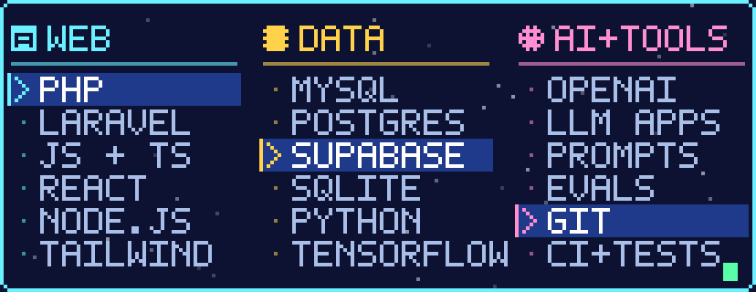

  

  <a href="https://bryanrumuy-porto.vercel.app/">Portofolio</a> &nbsp;|&nbsp;
  <a href="https://www.linkedin.com/in/bryanrumuy">LinkedIn</a> &nbsp;|&nbsp;
  Surabaya, Indonesia

Lulusan Teknik Informatika Universitas Surabaya (Data Science dan Artificial Intelligence). Saya membangun sistem web full-stack dan solusi AI untuk kebutuhan bisnis nyata. Terbuka untuk peran Web Developer, Data Scientist, dan AI Automation.

  

- **HanziLearn** (freelance): aplikasi manajemen les Mandarin untuk guru dan murid, dengan jadwal, PR, tagihan, latihan kosakata HSK, dan notifikasi push. React, Supabase, Cloudflare. Repo privat.
- **Sistem Keuangan Kantor** (freelance): pencatatan keuangan kantor dengan persetujuan transaksi, 2FA, laporan PDF dan Excel, dan 840+ tes otomatis. Laravel, MySQL. Repo privat.
- **FL Beauty** (kerja praktik kampus): sistem penjualan, pembelian, dan stok per batch kedaluwarsa untuk toko skincare. PHP, MySQL.
- **[Alter](https://github.com/bryanrumuy/alter-ai-assistant)**: asisten layanan pelanggan berbasis AI, proof of concept dengan kafe fiktif. Node.js, OpenAI API.
- **[Blockchain WFH Monitoring](https://github.com/bryanrumuy/blockchain-wfh-monitoring)**: proyek kuliah kelompok dengan Hyperledger Fabric.
- **HerbalScan** (skripsi): pengenal 10 tanaman obat dari foto daun, 15 model suara bersama, akurasi 99,34% pada pengujian.

Detail dan tangkapan layar ada di [portofolio](https://bryanrumuy-porto.vercel.app/projects).

  

Seluruh gambar pixel art digambar lewat kode (folder `tools`, jalankan `npm run mecha`). Desain mecha dan drone orisinal, terinspirasi anime robot klasik dan bukan karakter resmi milik siapa pun.
